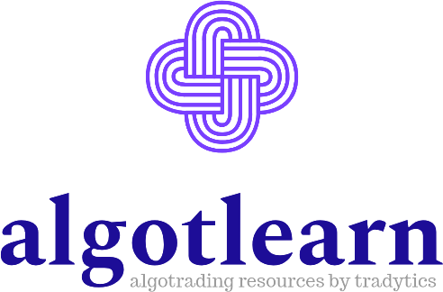

  

# algotlearn
Algotrading learning resources curated by Tradytics. As we ourselves learn more about algotrading and build more automated tools, we want to share our progress, journey, and the resources we are using with the algotrading community.

> [!NOTE]
> **Live Market Data API and MCP Server from Tradytics:** Connect Claude, ChatGPT, Cursor, or your Python and JavaScript scripts to options flow, dark pool prints, dealer gamma, stock perpetuals, prediction market odds, and company research.
> - **Hosted MCP:** [`https://tradytics.com/mcp`](https://tradytics.com/docs/mcp) (Streamable HTTP + OAuth) | **Agent skill:** `npx skills add tradytics/skills`
> - **REST API & SDKs:** `pip install tradytics` | `npm install tradytics` | [Docs](https://tradytics.com/docs) | [Starter repo](https://github.com/tradytics/options-flow-mcp-starter)

## Books
- [Advances in Financial Machine Learning](https://www.amazon.com/Advances-Financial-Machine-Learning-Marcos/dp/1119482089)

## Research Papers
- Eigen Portfolio Selection:  A RobustApproach to Sharpe Ratio Maximization
